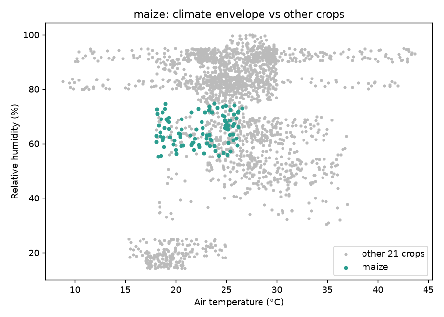
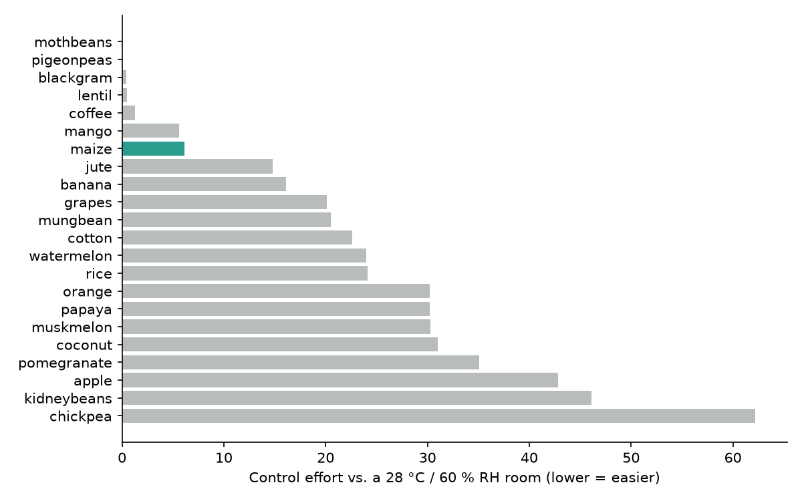
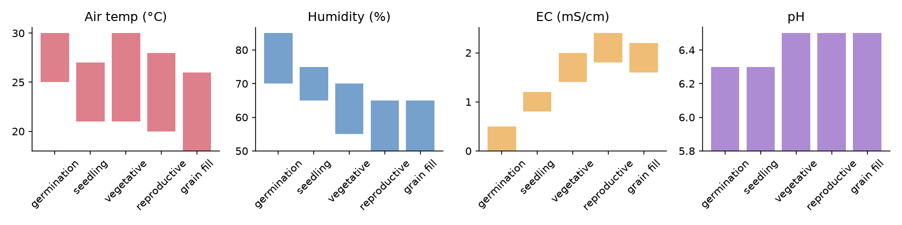
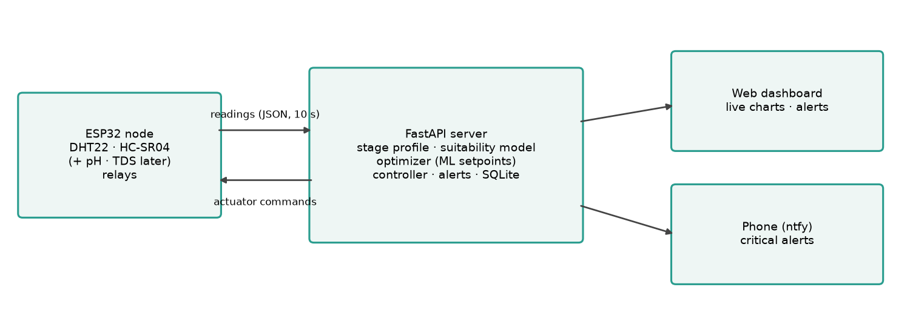
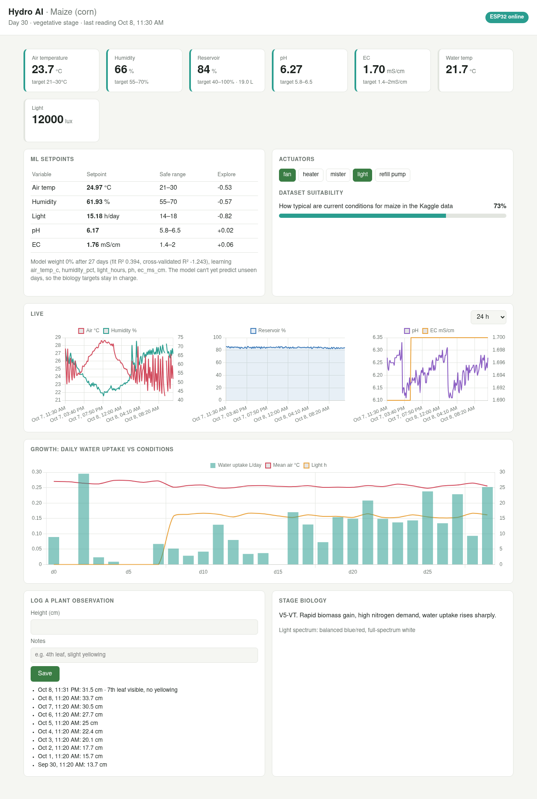
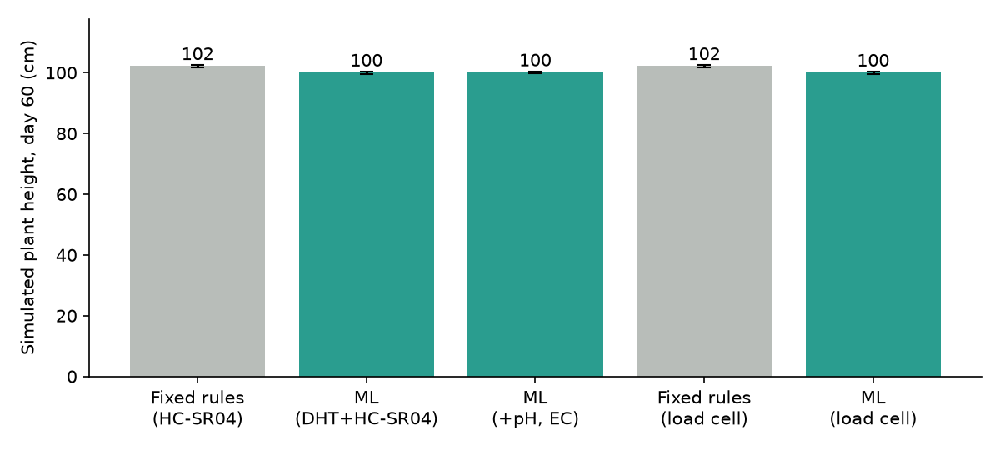
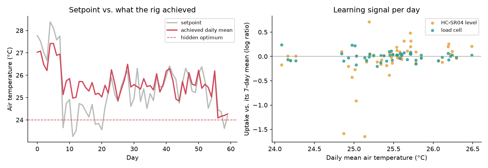

# An AI-Powered, Closed-Loop Hydroponic System for Maize

**Project report: design, implementation and simulated evaluation**
October 2026

---

## Abstract

Conventional automated hydroponic systems apply fixed rules such as "dose acid when pH exceeds 6.5". The best
conditions for a plant are not fixed, though: they change with growth stage, time of day and the environment.
This project builds a closed-loop system for **maize (corn)**. An ESP32 sensor node reports to a server, which holds
stage-specific biological targets, learns from the plant's own response, commands actuators and alerts the user
through a live dashboard.

The Kaggle *Crop Recommendation* dataset was used to select and characterise the crop and to train a "condition
suitability" model (ROC-AUC 0.97 using only temperature, humidity and pH). Since the sensing hardware is not yet
complete, the whole loop was tested against a physics-based plant simulator: 15 simulated 60-day grows across
5 configurations.

**Main findings:**
- **The software works end to end:** the full pipeline (sensing → storage → control → alerting → dashboard) runs
  and holds pH and EC in range.
- **Bad learning was blocked:** a naïve optimizer moved setpoints in the *wrong* direction. A cross-validation
  guard now stops a model with no predictive skill from changing anything.
- **Learning needs better hardware and experiment design, not a better algorithm.** With the planned hardware,
  daily water uptake is too noisy, and the achievable temperature range too narrow, for the plant's response to
  be learned from a single plant within one season. The report sets out the specific changes that would make
  learning possible.

---

## 1. Problem statement and objectives

| Objective | Status |
|---|---|
| Research stage-specific needs of the chosen plant (pH, EC, light, temperature, humidity) | Done: 5-stage profile (§4), **needs verification by the biology team** |
| Sensor + actuator node on a microcontroller | Firmware done and compiling; DHT22 + HC-SR04 available, relays/probes pending |
| ML model that predicts optimal settings and refines itself from new data | Done: response-surface optimizer with self-assessment (§6.3) |
| Web UI: real-time monitoring, graphs, out-of-range alerts | Done (§6.5) |
| Empirical data from a real grow | **Pending hardware**; simulated evaluation in §7 |

---

## 2. Dataset analysis

**Source:** Kaggle *Crop Recommendation Dataset* (atharvaingle), 2,200 rows. Each row has soil N, P and K, air
temperature, relative humidity, pH, rainfall and a crop label. There are 22 crops with exactly 100 rows each.

**What we found:**

- **The data looks synthetic.** Every crop has an N spread of almost exactly 40, a P spread of 25 and a K spread
  of 10, sampled uniformly. Real field data is never this regular.
- **It describes soil cultivation, not hydroponics.** N/P/K are soil ratios, not nutrient-solution concentrations,
  and rainfall means nothing indoors.
- **It has no growth stage, time or yield column.** It tells us *where a crop grows* but not *what maximises its
  growth*, so it cannot directly train an "optimal setpoint" model.

**How we use it anyway:**

1. **Crop selection:** each crop's climate band is compared with the room we can actually provide.
2. **The maize envelope:** a sanity bound on targets (table below).
3. **A suitability model:** a random forest trained on the three variables we can sense (temperature, humidity,
   pH) to estimate how typical current conditions are for maize. Five-fold ROC-AUC is **0.967**, or 1.00 with
   N/P/K included.

| Maize, 5th–95th percentile | Range |
|---|---|
| Temperature | 18.3 – 26.0 °C |
| Humidity | 56.5 – 73.6 % |
| pH | 5.59 – 6.87 |
| N / P / K (soil ratio) | 61–99 / 35–60 / 15–25 |



---

## 3. Crop selection

Each crop was scored by how far its temperature/humidity band sits from a typical Indian indoor room
(about 28 °C / 60 % RH). Temperature is weighted 3× because heating or cooling is harder than misting.



**Maize was chosen** (ranked 7 of 22). It has a well-defined, moderate climate band and a large, measurable
water demand, which matters for the growth signal in §6.3. Hydroponic maize is also established practice in
India (fodder systems).

**Implications:**
- Maize's upper limit of about 26 °C is below room temperature, so **cooling (exhaust fan or evaporative cooler)
  is the most important actuator.**
- A full plant grows to about 2 m over about 110 days. A dwarf/sweet-corn variety, or 7–10-day **maize fodder
  trays**, would give many more grow cycles per semester. The stage lengths in `config/maize.json` can be edited
  to match.

---

## 4. Biological targets by growth stage

The dataset has no stage information, so the stage-wise targets come from general hydroponic maize guidance.
The dataset envelope is shown alongside on the dashboard for comparison. They serve as the system's *prior*: the starting point that the ML layer
may later refine. **These values must be verified by the biology team before a real grow.**

| Stage | Days | Air temp (°C) | RH (%) | pH | EC (mS/cm) | Light (h) | Spectrum |
|---|---|---|---|---|---|---|---|
| Germination | 0–7 | 25–30 | 70–85 | 5.8–6.3 | 0–0.5 | 0 | none (dark) |
| Seedling (V1–V4) | 8–21 | 21–27 | 65–75 | 5.8–6.3 | 0.8–1.2 | 16 | blue-heavy |
| Vegetative (V5–VT) | 22–55 | 21–30 | 55–70 | 5.8–6.5 | 1.4–2.0 | 16 | balanced / full-spectrum |
| Reproductive (VT–R1) | 56–70 | 20–28 | 50–65 | 5.8–6.5 | 1.8–2.4 | 14 | red-heavy |
| Grain fill (R2–R6) | 71–110 | 18–26 | 50–65 | 5.8–6.5 | 1.6–2.2 | 13 | red-heavy |



How the targets change through the season:
- **pH:** stays slightly acidic throughout. Nitrate uptake pushes pH upward over time, which is why acid ("pH down")
  dosing is the common correction.
- **EC:** starts low to avoid salt stress in seedlings and rises with nutrient demand.
- **Humidity:** falls in the reproductive stage, because pollen sheds poorly in very humid air.
- **Light:** shifts from blue (compact vegetative growth) to red (flowering and grain fill).

---

## 5. System architecture



The ESP32 is deliberately kept simple: it measures, reports and obeys. All decisions are made on the server, which
can be updated without reflashing and has the compute for ML. If the server cannot be reached for three
consecutive reports, the node falls back to local safety rules:
- fan on above 30 °C;
- pumps off;
- lights on a fixed schedule, using time from NTP (internet time).

### 5.1 Hardware: available now

| Part | Pin | ESP32 | Note |
|---|---|---|---|
| DHT22 (or DHT11) | DATA | GPIO4 | 10 kΩ pull-up if it's a bare sensor |
| HC-SR04 | VCC / GND | 5 V / GND | mounted on the reservoir lid, facing down |
| HC-SR04 | TRIG | GPIO5 | |
| HC-SR04 | ECHO | GPIO18 **through a 1 kΩ/2 kΩ divider** | ECHO is 5 V; the ESP32 is 3.3 V only |

The ultrasonic sensor measures the reservoir water level, which gives two things:
- refill control;
- the plant's **daily water uptake**, used as the growth signal (§6.3).

### 5.2 Hardware: planned (pins already reserved in firmware)

| Item | Purpose | Pin |
|---|---|---|
| 4–8 channel relay module | switch actuators | — |
| Exhaust / evaporative fan | cooling, venting humidity | GPIO25 |
| LED grow light (red/blue or full-spectrum) | photoperiod | GPIO26 |
| Refill pump (from a fresh-water jug) | top-up and EC dilution | GPIO27 |
| Ultrasonic mister | humidity | GPIO32 |
| pH probe board (PH-4502C) | pH | GPIO34 (ADC1) |
| TDS/EC board | nutrient strength | GPIO35 (ADC1) |
| Peristaltic pumps ×3 | pH up, pH down, nutrient dosing | configurable |
| **HX711 + load cell (recommended, §8)** | precise reservoir weight | — |

The pH and TDS boards must use ADC1 pins, because ADC2 stops working while WiFi is on. Their outputs can reach
5 V and need a voltage divider.

---

## 6. Software

### 6.1 Firmware (`firmware/`, PlatformIO / Arduino)

- **Every 10 s:**
  - reads the DHT;
  - takes 5 ultrasonic pings and uses the median, correcting the speed of sound for air temperature;
  - reads the optional pH/TDS probes.
- POSTs the readings as JSON and switches relays according to the server's reply.
- Dosing pulses are hard-capped at 3 s, so a faulty command cannot empty a bottle.
- Build size: 71 % of flash, 14 % of RAM.

### 6.2 Control layer (`hydro/controller.py`)

The ML layer chooses *where* to hold the environment. The control layer *holds it there*, using hysteresis so
the relays don't chatter:

- **Fan:** above the temperature setpoint +0.7 °C, or when humidity is too high.
- **Heater** (if fitted): below the setpoint −1.4 °C.
- **Mister:** below the humidity setpoint −4 %. Never runs at the same time as the fan.
- **Lights:** follow the photoperiod schedule.
- **Refill pump:**
  - runs when the reservoir drops below 40 % and stops at 90 %;
  - also runs to dilute the solution when EC is too high.
- **pH and nutrient dosing:** 0.8 s pulses with a 10-minute cool-down so the reservoir can mix.
- **Sensor failure:** a failed DHT forces the heater and mister off.

### 6.3 Machine-learning layer

**(a) Suitability model:** the random forest from §2, shown on the dashboard as a percentage.

**(b) Growth signal.** Transpiration is closely tied to photosynthesis and biomass, so the plant's daily
**water uptake** is used as a proxy for growth. It can be measured with the hardware available today.
- **Problem:** summing every small drop in water level would count sensor jitter as uptake. The first version
  reported about 3 L/day of uptake before the seeds had even sprouted.
- **Fix:** the estimator splits each day at the moments the server commanded the refill pump. It fits a
  straight line to each pump-free stretch and uses the slope as the uptake rate.
- **Test:** on synthetic data with HC-SR04-level noise (true value 0.5 L/day), it is unbiased: mean
  0.498 L/day, standard deviation 0.107 L/day.

**(c) Setpoint optimizer** (`hydro/optimizer.py`):

1. **Daily table:** one row per complete day, with the mean conditions achieved (temperature, humidity, light
   hours, and pH/EC when present) and that day's uptake.
2. **Detrending:**
   - Raw uptake rises about 10× over the season as the plant grows. That swamps the few-percent effect of
     conditions, and the trend gets wrongly credited to anything else that drifts over the season.
   - An early version learned to *reduce* light for exactly this reason.
   - The target is therefore each day's uptake *relative to its surrounding 7-day mean*.
3. **Model:**
   - A quadratic response surface (ridge regression on x and x² of each variable). A quadratic is used because it
     has an explicit optimum and readable coefficients.
   - Interaction terms are added only once there are ≥ 10 days of data per term, to avoid overfitting.
4. **Recommendation:** the model's best point inside the biology-safe range for the current stage, blended with
   the biology prior. The weight is:
   `w = n/(n+14) × max(0, cross-validated R²)`, where n is the number of complete days.
   A model that cannot predict days it hasn't seen therefore has **zero influence**.
5. **Exploration:** each day the setpoints are nudged by up to ±1 °C, ±4 % RH and ±1 h of light, so the data
   contains variation to learn from.

### 6.4 Alerts

The system raises alerts for:
- any value outside the current stage's range (*warning* or *critical* depending on how far out);
- reservoir below 20 %;
- a DHT or ultrasonic sensor failure;
- the node going offline for more than 90 s.

A warning must persist for 5 minutes before it is raised, so noisy readings don't cause a flood. Critical alerts
can be pushed to a phone via ntfy.sh.

### 6.5 Dashboard



---

## 7. Evaluation by simulation

### 7.1 Simulator

`simulator/simulate.py` stands in for both the ESP32 and the plant. It POSTs the same JSON as the firmware and
obeys the actuator commands. It models:
- **the room:** a diurnal Indian-room climate, 24–32 °C;
- **the actuators:** fan (−5 °C), heater, mister and grow-light heat;
- **the plant:** logistic growth, with water uptake depending on size × condition quality;
- **solution chemistry:** pH drift, EC concentration as the plant drinks, and dilution by refills;
- **sensor faults:** noise and occasional DHT read failures.

The virtual plant has a **hidden optimum of 24 °C, 63 % RH and 17 h of light**, which the server is never told.

### 7.2 Experiments

There were five configurations, each run with 3 random seeds over 60 simulated days. "Load cell" means
level-sensor noise was reduced from 0.2 cm (HC-SR04) to 0.01 cm.

| Configuration | Day-60 height (cm), mean [range] | Model weight at day 60 | Cross-validated R² |
|---|---|---|---|
| Fixed biology rules, HC-SR04 | 102.2 [101.8–102.4] | — | — |
| ML, DHT + HC-SR04 (current hardware) | 100.0 [99.6–100.3] | 0 | −8.7 |
| ML, + pH and EC probes | 100.1 [99.8–100.3] | 0 | −9.5 |
| Fixed biology rules, load cell | 102.2 [101.8–102.4] | — | — |
| ML, load cell | 100.0 [99.6–100.3] | 0 | −0.68 |





### 7.3 Interpretation

1. **The control loop works.**
   - pH was held at 5.9–6.3 by about 40 pH-down doses over 20 days.
   - EC held steady at about 1.07 mS/cm once fresh-water dilution was added. Before that fix it drifted to 4.2.
   - Reservoir refills, light scheduling and alerts all behaved correctly.
2. **The ML layer correctly declined to act.**
   - By day 60 its cross-validated R² was negative in every run, so the guard had set its weight to 0.
   - Without the guard, earlier versions of the optimizer moved setpoints *away* from the optimum. One run pushed
     temperature to 28.8 °C and light to the bottom of its range, and the plant ended about 20 % shorter (82 cm vs
     102 cm) than with fixed rules.
3. **The ~2 % height gap is the cost of exploration.** Daily nudges away from a prior that already sits close to
   the optimum slightly reduce growth.
4. **The real bottlenecks are the signal, not the algorithm:**
   - **Measurement noise.** A ±2 mm ultrasonic reading on a 30 × 30 cm tank gives about ±0.1 L/day of noise in
     daily uptake, while the effects we want to detect are a few percent of 0.2–0.7 L/day. A load cell reduces
     the spread about fivefold (right panel above).
   - **Control authority.** The fan cannot pull an afternoon at 32 °C down to a 24 °C setpoint, so the daily mean
     temperature only spanned about 24–26.5 °C (left panel). With so little variation in the input, even a perfect
     sensor shows no slope.

**Caveat:** these are *simulated* results. The simulated plant response is invented. The experiments show how the
software behaves and roughly how much signal is needed, not real maize physiology.

---

## 8. Limitations and recommendations

**Before a real grow:**
1. The biology team verifies the stage targets in `config/maize.json`.
2. Calibrate the pH probe (buffers at pH 4 and 7) and the TDS probe, then measure the real tank geometry and set
   it via `/api/settings`.

**To make the learning loop actually learn:**
3. **Weigh the reservoir instead of pinging it.** An HX711 and load cell cost about ₹300 and resolve a few grams
   (millilitres).
4. **Run parallel trays (A/B).** Two or more trays under different setpoints on the same day remove the
   day-to-day and plant-size confounds entirely. This is the most effective single change.
5. **Hold each perturbation longer and make it bigger.** For example, alternate 3-day blocks 2–3 °C apart. That
   requires real cooling capacity, such as an evaporative cooler.
6. **Use a direct growth target.** Add a camera for daily leaf-area estimates, or regular height and leaf-count
   logs (the dashboard already accepts these), as a second signal alongside uptake.

**Extensions:**
7. The CV plant-health project fits on top of this: an ESP32-CAM / Pi camera with a CNN for deficiency detection,
   feeding the same alert system.
8. A Bayesian-optimisation or bandit layer could replace the ridge surface once the measurement noise problem
   above is solved.

---

## 9. Reproducing this report

```bash
python -m venv .venv && .venv/bin/pip install -r requirements.txt
.venv/bin/python analysis/analyze_dataset.py          # dataset analysis, envelope, suitability model
.venv/bin/python analysis/run_experiments.py --seeds 3 # 15 simulated 60-day grows (~5 min)
.venv/bin/python analysis/report_figures.py           # figures + report/data/summary.csv
```

Live system: `uvicorn hydro.server:app --host 0.0.0.0 --port 8000`, then either flash the ESP32
(`firmware/`, set WiFi and server IP in `include/secrets.h`) or run `simulator/simulate.py`.

### Appendix A: API

| Method | Path | Purpose |
|---|---|---|
| POST | `/api/readings` | ESP32 report → returns actuator commands + setpoints |
| GET | `/api/status` | latest reading, stage, setpoints, suitability, alerts |
| GET | `/api/readings?hours=24` | time series for charts |
| GET | `/api/history/daily` | daily table used for learning |
| GET | `/api/alerts` | alert history |
| POST | `/api/observations` | manual height / notes |
| GET/POST | `/api/settings` | planting date, tank geometry, ML on/off, exploration |

### Appendix B: Code layout

```
analysis/       dataset analysis, experiment runner, report figures
config/         maize stage profile, dataset envelope
hydro/          FastAPI server: db, optimizer, controller, alerts, suitability, dashboard
simulator/      fake ESP32 + plant
firmware/       ESP32 PlatformIO project
report/         this report, figures, experiment data
```
